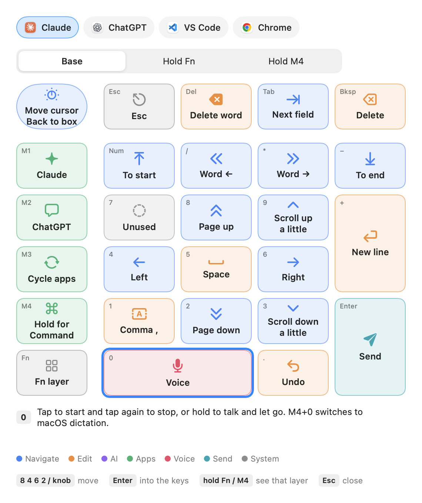

<div align="center">

# PromptPad

A macro keypad as a remote control for voice-first AI work on macOS.

[](https://github.com/CartemisAI/PromptPad/actions/workflows/build.yml)
[](LICENSE)
[](#install)

English · [中文](README.zh-CN.md)



</div>

## Features

- One key for voice input in Claude, ChatGPT or macOS dictation.
- Send, queue, switch chats, scroll and insert quick replies from the keypad.
- Read-only file navigation in VS Code; tabs and history in Chrome.
- Microphone switching and an on-screen key map (Fn+NumLock).
- Every key, app and quick reply is defined in one layout file.
- No network access and no dependencies.

The default layout targets the Keychron K0 Max. Any keypad that can send F13–F20 key combinations works.

## Install

Requires macOS 14+ and the Xcode Command Line Tools.

```sh
git clone https://github.com/CartemisAI/PromptPad.git && cd PromptPad
./scripts/make-signing-cert.sh   # optional: keeps permissions across rebuilds
./build.sh                       # installs ~/Applications/PromptPad.app
```

Open PromptPad, grant Accessibility and Input Monitoring, then connect the keypad by USB and choose **Customize → Write Layout to Keypad**.

## Usage

Override keys in `~/Library/Application Support/PromptPad/layout.json` (**Customize → Edit My Layout…**), then choose **Customize → Reload Layout**. Your file is merged on top of the default layout.

## Documentation

- [Key reference](docs/keys.md)
- [Customization](docs/customize.md)
- [Contributing](CONTRIBUTING.md)

## License

[MIT](LICENSE). Claude, ChatGPT, VS Code, Chrome and Keychron are trademarks of their respective owners.

---

<p align="center">Built by <a href="https://cartemis-ai.com/">Cartemis AI</a></p>
