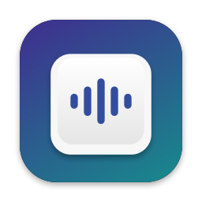
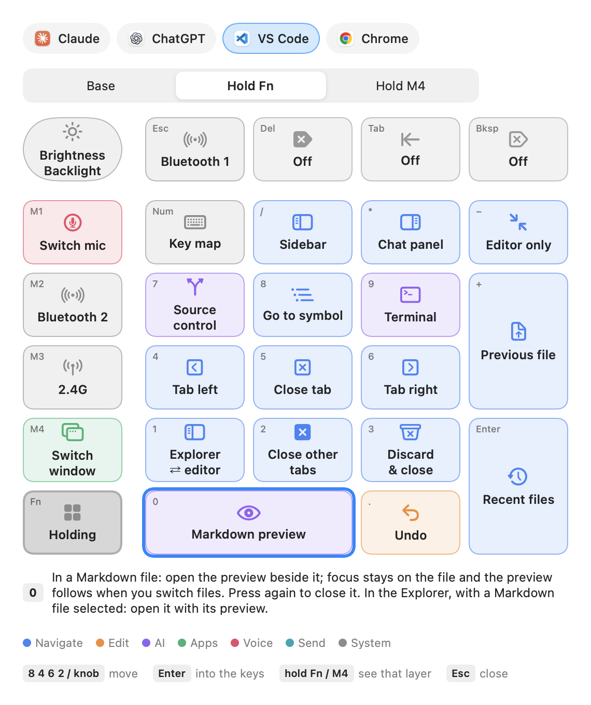
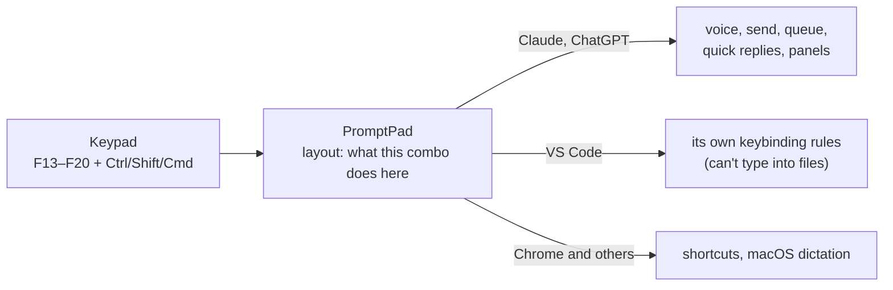

<div align="center">



# PromptPad

**Turn a macro keypad into a remote control for voice-first work with AI on your Mac.**

Talk with one key. Send, switch chats, scroll and browse files without touching the keyboard or mouse.

[](https://github.com/CartemisAI/PromptPad/actions/workflows/build.yml)
[](LICENSE)


[Features](#features) · [Every key](docs/keys.md) · [Install](#install) · [Make it yours](#make-it-yours) · [FAQ](#faq) · [中文说明](README.zh-CN.md)


</div>

## Why

Coding with an AI assistant is mostly talking: describe, listen, approve, send. Doing that with a mouse and a full
keyboard means constant reaching. PromptPad puts the whole loop on a 27-key keypad next to you: one key to talk,
one to send, a layer of quick replies, and the same keys do the matching thing in every app.

## Features

| | |
|---|---|
| 🎙️ **Voice key** | Tap to start and stop, or hold to talk and let go. Uses each app's own voice input or macOS dictation. In Claude, Fn+0 asks a `/btw` side question by voice. |
| 💬 **Chat apps** | Send, queue for later, send now, jump to session N, previous / next session, fine scrolling, one-key quick replies, side chat and panels. |
| 📂 **VS Code as a reader** | Open files from the Explorer, next / previous file, Markdown preview beside the file, tabs left and right, discard & close, undo. The keypad can't change a file by accident. |
| 🌐 **Chrome** | Tabs, back and forward, the address bar, reopen the closed tab. |
| 🎧 **Microphones** | Switch the Mac's microphone (built-in, USB, AirPods, iPhone) from the keypad, with a list on screen. |
| ⌨️ **Key map** | Fn+NumLock shows what every key does in the app you're in, layer by layer. Move around it with the keypad. |
| 🧩 **Yours to change** | Every key, app, voice method and quick reply is data in one layout file. Add apps; add devices as add-ons. |
| 🛡️ **Safe to leave running** | Pause, quit or uninstall from the menu bar. Nothing runs at login unless you turn it on. Uninstall puts the keypad and VS Code back the way they were. |

Works with **Claude**, **ChatGPT**, **VS Code** and **Chrome** out of the box. The default layout is made for the
**Keychron K0 Max** (QMK/VIA, 27 keys and a knob); any keypad that can send F13–F20 key combos works.
Every key on every layer in every app: **[docs/keys.md](docs/keys.md)**.

<div align="center">

</div>

## How it works



The keypad's firmware sends key combos no keyboard normally uses. PromptPad catches them before any app sees them,
looks up what that combo does in the app in front, and does it: presses a button through macOS Accessibility,
posts a shortcut, pastes a reply. Holding **Fn** or **M4** switches layers, so each key has three jobs.

## Install

Built on your own Mac from this source: no Apple developer account, no notarization, nothing to download but the
code. Needs macOS 14 or later and the Xcode Command Line Tools (`xcode-select --install`).

```bash
git clone https://github.com/CartemisAI/PromptPad.git && cd PromptPad
./scripts/make-signing-cert.sh   # optional, once: keeps permissions across rebuilds
./build.sh                        # builds and installs ~/Applications/PromptPad.app
```

1. **Open PromptPad** from `~/Applications` and grant **Accessibility** and **Input Monitoring** when macOS asks.
   It restarts itself after each.
2. **Write the layout**: connect the keypad by USB cable with its switch on wired, then menu bar →
   **Customize → Write Layout to Keypad**. Each key's previous setting is saved first, so
   **Restore Keypad Layout…** can undo it.
3. **VS Code** (optional): **Customize → Install VS Code Rules** adds PromptPad's rules next to your own shortcuts.
4. **Open at Login** (optional): in the menu, if you want it running after every restart.

<details>
<summary><b>Why the signing certificate?</b></summary>

macOS ties the Accessibility and Input Monitoring permissions to the app's signature. Without a certificate each
build is signed ad hoc and gets a new signature, so macOS asks for the permissions again after every rebuild.
`make-signing-cert.sh` makes a self-signed certificate (valid 30 years) in your login keychain once. It never leaves
your Mac, and Uninstall removes it. If signing ever fails, `build.sh` falls back to ad hoc signing and says why.
</details>

## Make it yours

Everything that is a habit is data, not code: which key does what in which app, which apps exist, how each app
starts voice input, the quick replies, what the key map shows. Put only your changes in
`~/Library/Application Support/PromptPad/layout.json` (**Customize → Edit My Layout…**); it is merged on top of the
default. Then **Customize → Reload Layout**.

```json
{
  "actions": {
    "shift+cmd+f19": { "claude": "say:Continue.", "chatgpt": "say:Continue." }
  }
}
```

- **Add an app**: one entry in `apps`, then its actions.
- **Add a device or app-specific code**: an add-on, a folder with a layout file and optional Swift. Your own go in
  `personal/` (git-ignored, never published); shared ones in `addons/`.
- **Add a language**: one JSON file in `Resources/i18n/`.

The full guide: **[docs/customize.md](docs/customize.md)**. Check a changed layout with `python3 scripts/check-layout.py`.

## Privacy and safety

- **No network.** PromptPad makes no network connections. Its log stays on your Mac, is capped at 512 KB, and doesn't
  record what you dictate or type.
- **Front app only.** Actions go to the app in front; nothing is typed or sent into a background app.
- **Read-only devices.** Input devices are read, never seized, so other apps (Zoom, headset software) keep working.
- **Clean uninstall.** Menu → **Uninstall…** removes the permissions, settings, logs, login item and VS Code rules,
  restores the keypad, and moves the app to the Trash.

## FAQ

<details>
<summary><b>Does it work with other keypads?</b></summary>

Yes, if the keypad can send F13–F20 with Ctrl / Shift / Cmd. QMK/VIA keypads can be written by PromptPad directly
(set the `device` and key positions in the layout); others can use their own software or Karabiner-Elements.
The key map window draws the K0 Max; another shape needs its own drawing.
</details>

<details>
<summary><b>What if an app renames its buttons?</b></summary>

Voice and send buttons are found by name. **Customize → List the Front App's Buttons** writes the current names to
`~/Library/Logs/PromptPad-dump.txt`; put the new ones in `config.json` (see the guide).
</details>

<details>
<summary><b>Why no Option key in the combos?</b></summary>

Claude opens its quick entry when Option is tapped twice, so combos that include Option would trigger it by accident.
`check-layout.py` rejects them.
</details>

<details>
<summary><b>Will it keep working for years?</b></summary>

Nothing grows over time: the log is capped, diagnostic files are overwritten or deleted after 3 days, and windows are
reused. If macOS pauses the key listener (it does that to slow listeners), PromptPad turns it back on and lets go of
any held key. What can change is the apps themselves, see "renames its buttons" above.
</details>

<details>
<summary><b>Project layout</b></summary>

```
Sources/              the app (Swift, built with swiftc; no Xcode project)
  App.swift             menu bar, key dispatch, actions, key map window
  KeypadTap.swift       catches the keypad's combos on its own thread
  Layout.swift          loads and merges layouts; apps; combo names
  Automation.swift      Accessibility: buttons, message box, menus, posting keys and text
  Voice.swift           the voice key
  Keyboard.swift        writes the layout to a VIA keyboard, with backup
  VSCode.swift          adds / removes PromptPad's block in VS Code's keybindings.json
  CheatSheet.swift      the key map window
  Localization.swift    interface language
  Addons.swift          add-on interface
Resources/            default layout, VS Code rules, translations, keypad factory settings, icon
scripts/              check-layout.py, make-signing-cert.sh, make-icon.sh
docs/                 customize guide (English, 中文), screenshots
personal/             your own add-ons and build settings (git-ignored)
```

`./build.sh --public` builds without `personal/`, `--universal` for Apple silicon and Intel, `--no-install` only builds.
</details>

## Contributing

Bug reports, layouts, translations and add-ons are welcome. See [CONTRIBUTING.md](CONTRIBUTING.md).

## License

[MIT](LICENSE). Claude, ChatGPT, VS Code, Chrome and Keychron are trademarks of their owners, named here only to
describe compatibility.
