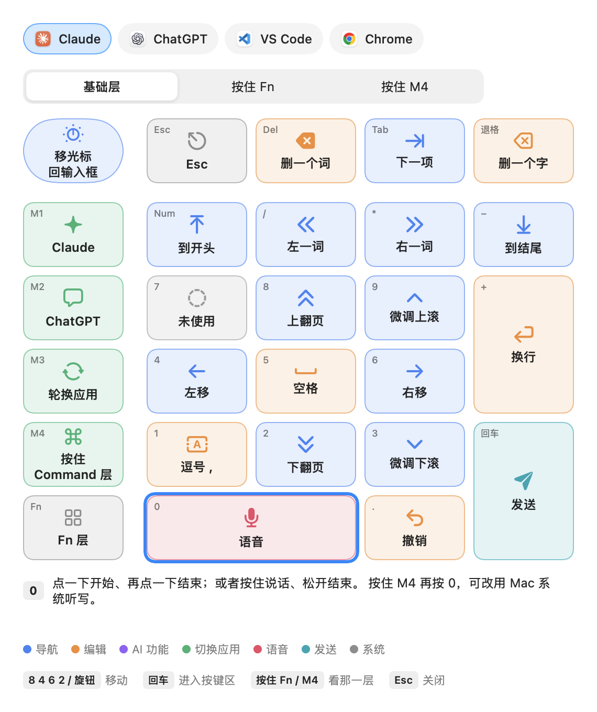

<div align="center">

# PromptPad

把宏小键盘变成 macOS 上语音使用 AI 的遥控器。

[](https://github.com/CartemisAI/PromptPad/actions/workflows/build.yml)
[](LICENSE)
[](#安装)

[English](README.md) · 中文



</div>

## 功能

- 一个键开关语音输入，支持 Claude、ChatGPT 或 macOS 听写。
- 用小键盘发送、排队、切换会话、滚动和插入常用回复。
- 在 VS Code 中只读浏览文件；在 Chrome 中切换标签页和前进后退。
- 切换麦克风，屏幕键位图（Fn+NumLock）。
- 每个键、应用和常用回复都定义在一个布局文件里。
- 不联网，无依赖。

默认布局为 Keychron K0 Max 设计，任何能发送 F13–F20 组合键的小键盘都可以使用。

## 安装

需要 macOS 14+ 和 Xcode 命令行工具。

```sh
git clone https://github.com/CartemisAI/PromptPad.git && cd PromptPad
./scripts/make-signing-cert.sh   # 可选：重新编译后保留权限
./build.sh                       # 安装到 ~/Applications/PromptPad.app
```

打开 PromptPad，授予“辅助功能”和“输入监控”权限，然后用 USB 连接小键盘，选择 **自定义 → 写入键盘布局**。

## 使用

在 `~/Library/Application Support/PromptPad/layout.json` 中覆盖按键（**自定义 → 编辑个人布局…**），然后选择 **自定义 → 重新加载布局**。该文件会叠加在默认布局之上。

## 文档

- [按键说明](docs/keys.zh-CN.md)
- [自定义](docs/customize.zh-CN.md)
- [参与贡献](CONTRIBUTING.md)

## 许可

[MIT](LICENSE)。Claude、ChatGPT、VS Code、Chrome 和 Keychron 是其各自所有者的商标。
