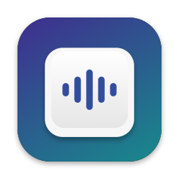
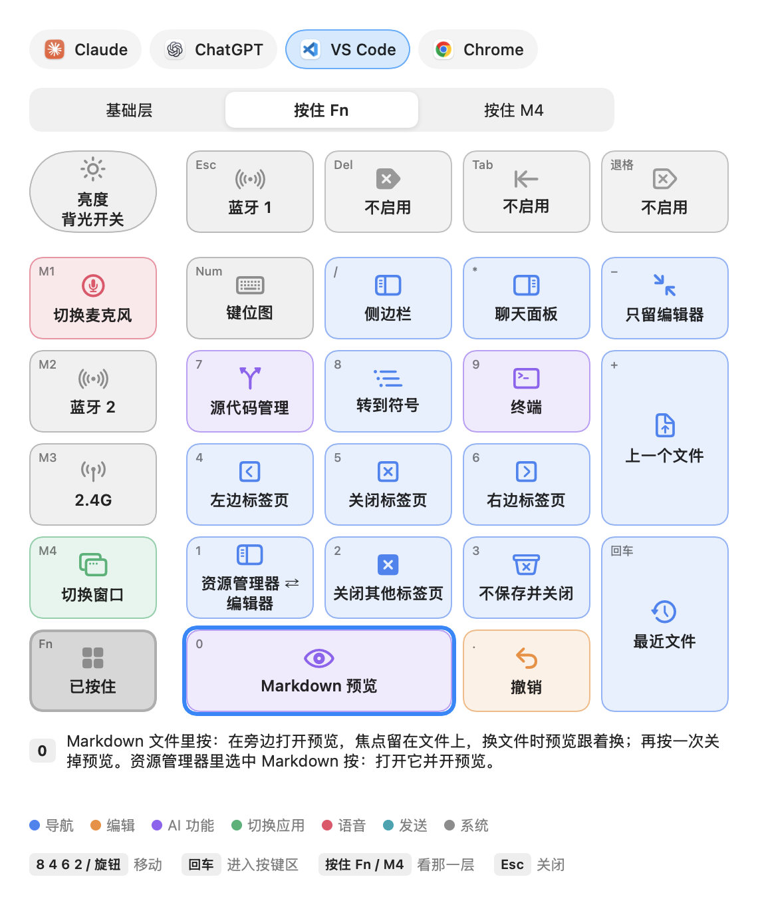
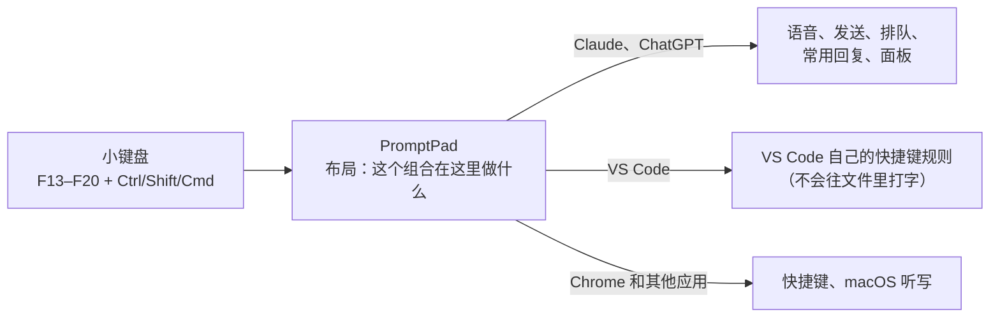

<div align="center">



# PromptPad

**把一个宏小键盘变成 Mac 上语音用 AI 的遥控器。**

一个键说话。发送、切会话、滚动、看文件，都不用碰键盘和鼠标。

[](https://github.com/CartemisAI/PromptPad/actions/workflows/build.yml)
[](LICENSE)


[功能](#功能) · [每个键](docs/keys.zh-CN.md) · [安装](#安装) · [改成你的习惯](#改成你的习惯) · [常见问题](#常见问题) · [English](README.md)


</div>

## 为什么做这个

跟 AI 一起写代码，大部分时间是在说话：描述、听回答、确认、发送。用鼠标和整把键盘来做这些，手要来回够。PromptPad 把这一整套放到手边一个 27 键的小键盘上：一个键说话，一个键发送，一层常用回复，而且同一个键在每个应用里做对应的同一类事。

## 功能

| | |
|---|---|
| 🎙️ **语音键** | 点一下开始、再点一下结束，或者按住说话、松开结束。用各应用自带的语音输入或 macOS 听写。在 Claude 里按 Fn+0，用语音问一个 `/btw` 顺便问题。 |
| 💬 **聊天应用** | 发送、稍后发送、立即发送、跳到第 N 个会话、上一个 / 下一个会话、微调滚动、一键常用回复、侧边聊天和各种面板。 |
| 📂 **把 VS Code 当阅读器** | 从资源管理器打开文件、上一个 / 下一个文件、在旁边开 Markdown 预览、左右切换标签页、不保存并关闭、撤销。小键盘不会误改文件。 |
| 🌐 **Chrome** | 标签页、后退和前进、地址栏、重新打开刚关掉的标签页。 |
| 🎧 **麦克风** | 用小键盘切换 Mac 的麦克风（内置、USB、AirPods、iPhone），屏幕上显示列表。 |
| ⌨️ **键位图** | Fn+NumLock 按层显示当前应用里每个键做什么，用小键盘就能在里面移动。 |
| 🧩 **都能改** | 每个键、应用、语音方式和常用回复都是一个布局文件里的数据。可以加应用；其他设备做成插件。 |
| 🛡️ **放心一直开着** | 在菜单栏暂停、退出或卸载。不打开“开机自动启动”就不会开机自启。卸载会把小键盘和 VS Code 恢复原样。 |

开箱支持 **Claude**、**ChatGPT**、**VS Code** 和 **Chrome**。默认布局为 **Keychron K0 Max**（QMK/VIA，27 个键加一个旋钮）设计；任何能发 F13 到 F20 组合键的小键盘都能用。界面有中文和英文，菜单“语言”里切换。每个应用、每一层、每个键的完整说明见 **[docs/keys.zh-CN.md](docs/keys.zh-CN.md)**。

<div align="center">

</div>

## 工作原理



小键盘的固件发出普通键盘不会用到的组合键。PromptPad 在任何应用收到之前截住它们，查出这个组合在前台应用里该做什么，然后去做：通过 macOS 辅助功能点按钮、发快捷键、粘贴一句回复。按住 **Fn** 或 **M4** 切换层，所以每个键有三种用法。

## 安装

在你自己的 Mac 上从源码编译：不需要苹果开发者账号，不用公证，只下载代码。需要 macOS 14 或更新，以及 Xcode 命令行工具（`xcode-select --install`）。

```bash
git clone https://github.com/CartemisAI/PromptPad.git && cd PromptPad
./scripts/make-signing-cert.sh   # 可选，只需一次：重新编译后不用再授权
./build.sh                        # 编译并装到 ~/Applications/PromptPad.app
```

1. **打开 PromptPad**（在 `~/Applications` 里），按 macOS 的提示打开“辅助功能”和“输入监控”。每开一个它会自动重启一次。
2. **写入布局**：用 USB 线连上小键盘、开关拨到有线档，然后菜单栏 → **自定义 → 写入键盘布局**。写之前会先保存每个键原来的设置，**还原键盘布局…** 能撤销。
3. **VS Code**（可选）：**自定义 → 安装 VS Code 规则**，把 PromptPad 的规则加在你自己的快捷键旁边。
4. **开机自动启动**（可选）：在菜单里打开，每次重启后都会自己运行。

<details>
<summary><b>为什么要本机签名证书？</b></summary>

macOS 把“辅助功能”和“输入监控”权限记在程序的签名上。没有证书时每次编译都是临时签名，签名都不一样，重新编译后就要重新授权。`make-signing-cert.sh` 在你的登录钥匙串里建一个自签名证书（有效期 30 年），只需一次。证书不会离开你的电脑，卸载时会一起删掉。万一签名失败，`build.sh` 会改用临时签名并说明原因。
</details>

## 改成你的习惯

所有属于习惯的东西都是数据，不是代码：哪个键在哪个应用里做什么、支持哪些应用、每个应用怎么开语音、常用回复说什么、键位图上写什么。只把你要改的部分写进 `~/Library/Application Support/PromptPad/layout.json`（**自定义 → 编辑个人布局…**），它会叠加在默认布局上。改完点 **自定义 → 重新加载布局**。

```json
{
  "actions": {
    "shift+cmd+f19": { "claude": "say:继续。", "chatgpt": "say:继续。" }
  }
}
```

- **加一个应用**：在 `apps` 里加一条，再配它的动作。
- **加设备或某个应用专用的代码**：做成插件，就是一个带布局文件、可选 Swift 代码的文件夹。自己用的放 `personal/`（不进 git，不会发布）；要分享的放 `addons/`。
- **加一种语言**：在 `Resources/i18n/` 里放一个 JSON 文件。

完整说明见 **[docs/customize.zh-CN.md](docs/customize.zh-CN.md)**。改了布局可以用 `python3 scripts/check-layout.py` 检查。

## 隐私与安全

- **不联网。** PromptPad 不建立任何网络连接。日志只在你的电脑上，最多 512 KB，不记录你口述或输入的内容。
- **只动前台应用。** 动作只发给前台应用，不会往后台应用里打字或发送。
- **只读设备。** 外接设备只读不独占，Zoom、耳机软件这些照常工作。
- **卸载干净。** 菜单 → **卸载…** 会撤销权限，删除设置、日志和登录项，移除 VS Code 规则，还原小键盘，最后把程序移到废纸篓。

## 常见问题

<details>
<summary><b>能用别的小键盘吗？</b></summary>

能，只要它能发 F13 到 F20 加 Ctrl / Shift / Cmd 的组合。QMK/VIA 小键盘可以由 PromptPad 直接写入（在布局里设好 `device` 和每个键的位置）；其他小键盘用它自带的软件或 Karabiner-Elements 设置。键位图窗口画的是 K0 Max 的形状，别的形状要另画。
</details>

<details>
<summary><b>应用改了按钮名字怎么办？</b></summary>

语音、发送这些按钮是按名字找的。**自定义 → 列出当前应用的按钮** 会把现在的名字写到 `~/Library/Logs/PromptPad-dump.txt`，把新名字填进 `config.json` 即可（见说明）。
</details>

<details>
<summary><b>组合键里为什么不用 Option？</b></summary>

连按两下 Option 会打开 Claude 的快速输入，带 Option 的组合很容易误触发。`check-layout.py` 会拒绝这样的组合。
</details>

<details>
<summary><b>能一直用好几年吗？</b></summary>

没有会随时间变大的东西：日志有上限，诊断文件会被覆盖或 3 天后删除，窗口都是复用的。macOS 嫌监听太慢时会暂停它，PromptPad 会马上重新打开，并松开所有按住的键。真正会变的是各个应用本身，见上面“改了按钮名字”。
</details>

<details>
<summary><b>项目结构</b></summary>

```
Sources/              程序（Swift，用 swiftc 编译，不需要 Xcode 项目）
  App.swift             菜单栏、按键分发、动作、键位图窗口
  KeypadTap.swift       在单独的线程上截住小键盘的组合键
  Layout.swift          载入并合并布局；应用；组合键名
  Automation.swift      辅助功能：按钮、输入框、菜单、发按键和文字
  Voice.swift           语音键
  Keyboard.swift        把布局写进 VIA 键盘，并先备份
  VSCode.swift          在 VS Code 的 keybindings.json 里增删 PromptPad 那一段
  CheatSheet.swift      键位图窗口
  Localization.swift    界面语言
  Addons.swift          插件接口
Resources/            默认布局、VS Code 规则、翻译、小键盘出厂设置、图标
scripts/              check-layout.py、make-signing-cert.sh、make-icon.sh
docs/                 自定义说明（English、中文）、截图
personal/             你自己的插件和编译设置（不进 git）
```

`./build.sh --public` 编译不含 `personal/` 的版本，`--universal` 同时编 Apple 芯片和 Intel，`--no-install` 只编译不安装。
</details>

## 参与

欢迎报问题，也欢迎新的布局、翻译和插件。见 [CONTRIBUTING.md](CONTRIBUTING.md)。

## 许可

[MIT](LICENSE)。Claude、ChatGPT、VS Code、Chrome、Keychron 等名称归各自所有者，这里只用来说明兼容性。
